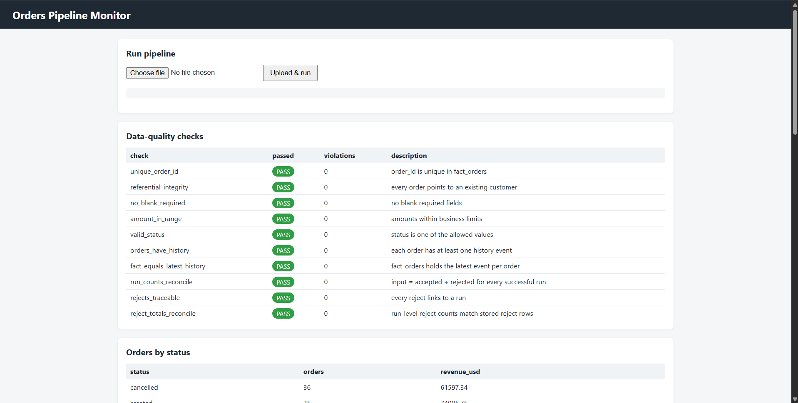
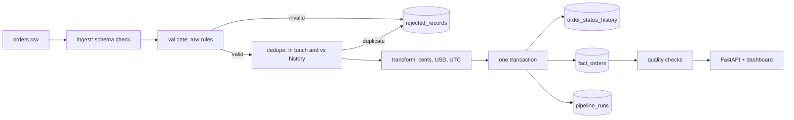

# Orders Pipeline: Ingestion, Validation and Data-Quality Tests

A CSV orders feed is validated, transformed and loaded into a SQLite warehouse. Bad rows are quarantined with a reason, reruns are safe, every run is audited, and a pytest suite plus SQL reconciliation checks prove the behaviour. A small dashboard shows run status, data-quality checks and rejected records.



## Architecture



## Project structure

```
order-pipeline/
├── backend/
│   ├── app/        config, db, ingest, validate, transform, load, pipeline, quality, generator, cli, api
│   ├── tests/      unit, integration, data-quality and regression tests
│   ├── scripts/    benchmark.py, run_queries.py
│   └── data/sample/  orders.csv, customers.csv, expected.json (labels kept separate from input)
├── frontend/       index.html, style.css, app.js (dashboard, no build step)
└── docs/           test results, reconciliation, benchmark, sample queries, design note
```

## Setup

```bash
cd backend
python -m venv .venv
.venv\Scripts\activate        # Windows. Mac/Linux: source .venv/bin/activate
pip install -r requirements.txt
```

## Run

```bash
python -m app.cli generate --orders 200 --customers 50 --seed 42 --out data/sample
python -m app.cli load-customers data/sample/customers.csv
python -m app.cli run data/sample/orders.csv
python -m app.cli run data/sample/orders.csv        # same file again -> SKIPPED
python -m app.cli quality
pytest -v
python scripts/benchmark.py
uvicorn app.api:app --reload                        # dashboard: http://127.0.0.1:8000
```

Source-to-target aggregate reconciliation (use a fresh database, because the check assumes the database was loaded from this one file):

```bash
python -m app.cli --db data/recon.db load-customers data/sample/customers.csv
python -m app.cli --db data/recon.db run data/sample/orders.csv
python -m app.cli --db data/recon.db reconcile data/sample/orders.csv
```

Larger run: `python -m app.cli generate --orders 100000 --customers 2000 --out data/large`, then load customers and run `data/large/orders.csv`.

## Data dictionary

| Table | Column | Type | Null | Notes |
|---|---|---|---|---|
| dim_customer | customer_id | TEXT PK | no | CUST-00001 format |
| | customer_name, country | TEXT | no | |
| fact_orders (grain: one row per order, latest state) | order_id | TEXT PK | no | ORD-000001 format |
| | customer_id | TEXT FK | no | must exist in dim_customer |
| | order_ts, updated_at | TEXT | no | ISO-8601 UTC |
| | order_date | TEXT | no | derived from order_ts (UTC) |
| | amount_cents | INTEGER | no | 1 to 10,000,000 |
| | currency | TEXT | no | USD, EUR, INR |
| | amount_usd_cents | INTEGER | no | derived, fixed FX rate, round half up |
| | status | TEXT | no | created, paid, shipped, cancelled, refunded |
| | source_file, run_id | TEXT | no | lineage |
| order_status_history (grain: one row per order event) | order_id, updated_at | PK | no | full event log, never overwritten |
| | status, run_id, source_file | TEXT | no | |
| rejected_records | reject_id | INTEGER PK | no | |
| | run_id, source_file, line_no | | no | traceable to the source line |
| | reason_code | TEXT | no | see codes below |
| | reason_detail | TEXT | yes | |
| | raw_record | TEXT | no | original row as JSON |
| pipeline_runs | run_id | TEXT PK | no | |
| | status | TEXT | no | RUNNING, SUCCESS, FAILED, SKIPPED |
| | file_hash, source_file, started_at | TEXT | no | |
| | ended_at, duration_sec, failure_reason | | yes | |
| | input_rows, accepted_rows, rejected_rows, duplicate_rows | INTEGER | no | default 0 |

Reject codes: MALFORMED_ROW, MISSING_REQUIRED_FIELD, INVALID_ORDER_ID, INVALID_STATUS, INVALID_CURRENCY, INVALID_AMOUNT, AMOUNT_OUT_OF_RANGE, INVALID_TIMESTAMP, FUTURE_TIMESTAMP, TIMESTAMP_ORDER, INVALID_REFERENCE, DUPLICATE_EVENT. A bad header (missing required column, empty file) fails the whole run instead.

## Naming conventions

snake_case tables and columns, ISO-8601 UTC timestamps, deterministic IDs (ORD-######, CUST-#####), `run_id = run_<utc timestamp>_<file hash prefix>`, money stored as integer cents.

## Assumptions

- FX rates are fixed (EUR 1.08, INR 0.012) and live in `config.py`.
- Timestamps without a timezone are treated as UTC, and all timestamps are stored in UTC.
- Amounts must be between 0.01 and 100,000.00 inclusive, with at most two decimals.
- An event is identified by (order_id, updated_at). The first occurrence wins. Later copies, whether in the same file or in a file loaded earlier, are quarantined as DUPLICATE_EVENT.
- Extra columns in the file are ignored with a warning. Missing required columns fail the run.
- The customer reference file is trusted and loaded before orders.

## Idempotency, retry and backfill

- A file whose content hash already has a SUCCESS run is SKIPPED, so reruns add nothing.
- Overlapping files are safe. An event already in history is quarantined as DUPLICATE_EVENT and counted, and the fact upsert applies only when updated_at is newer, so late or out-of-order data never overwrites newer state.
- Each file loads in one transaction. A failure rolls everything back and marks the run FAILED. Retrying means running the same file again, because only SUCCESS blocks a rerun.
- Backfill: load older files in any order and the result converges to the latest event per order.

## Testing

44 tests in `backend/tests/`:

- **Unit:** every validation rule, amount boundaries (0.01 and 100,000.00 inclusive), missing fields, malformed rows, timezone normalisation, FX conversion and half-up rounding.
- **Integration:** happy path, empty batch, empty file, schema change, extra column, rejects traceable to file and line, duplicates, cross-file duplicates, rerun, overlapping files, late-arriving and out-of-order events, partial failure with rollback and retry, missing file.
- **Data quality:** a seeded 2,000-row file with labelled bad records must produce exactly the expected counts per reject code, and every SQL quality check must pass. A source-to-target aggregate reconciliation test compares order count and amount totals.
- **Regression:** inclusive upper amount boundary, equal-timestamp events do not flip state, same seed gives identical output.

## Results

- Tests: 44 passed (`docs/test_results.txt`)
- Sample run: input 200, accepted 174, rejected 26, duplicates 2, matching `data/sample/expected.json`
- Quality checks: 10 of 10 pass (`docs/reconciliation.txt`)
- Source-to-target aggregates reconcile: 168 orders, 52,442,529 total amount cents, 39,650,504 total USD cents (`docs/reconciliation_aggregates.txt`)
- Sample queries and output: `docs/sample_queries.sql`, `docs/sample_queries_output.txt`
- Benchmark (100,000 rows, seed 42, local Windows machine): 18.47 s end-to-end, about 5,414 rows/s (`docs/benchmark_results.txt`). Includes one indexed history lookup per accepted row for cross-file duplicate detection. Timings vary between runs on the same machine.
- Optimization: all writes are batched with `executemany` inside one transaction. In an isolated micro-benchmark of 20,000 inserts, a commit per row took 76.60 s versus 0.10 s for one batched transaction. The gap is exaggerated by per-commit disk syncs on Windows, so the exact ratio varies by machine.
- Next optimization: stream the file in chunks of about 10k rows instead of holding all events in memory.

## Known limitations and next steps

- SQLite allows a single writer and has no distributed scale. A warehouse such as Postgres or BigQuery would replace it.
- The whole file is held in memory per run. The next step is chunked streaming.
- Aggregate reconciliation assumes the database was loaded from the single file being checked.
- FX rates are static, the customer file must be clean (it fails fast), and the API has no authentication.

See `docs/DESIGN.md` for the design and trade-off notes.